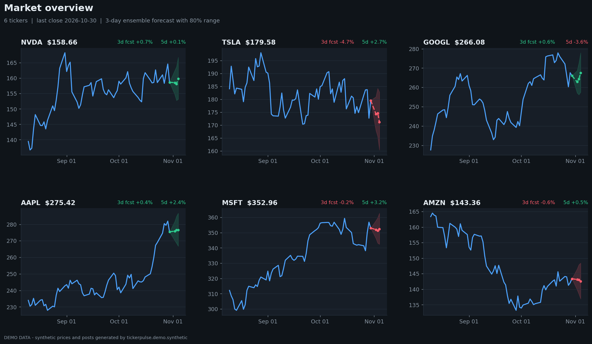
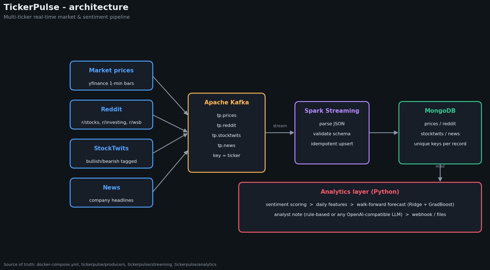
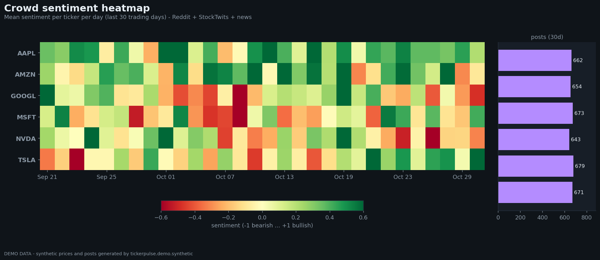
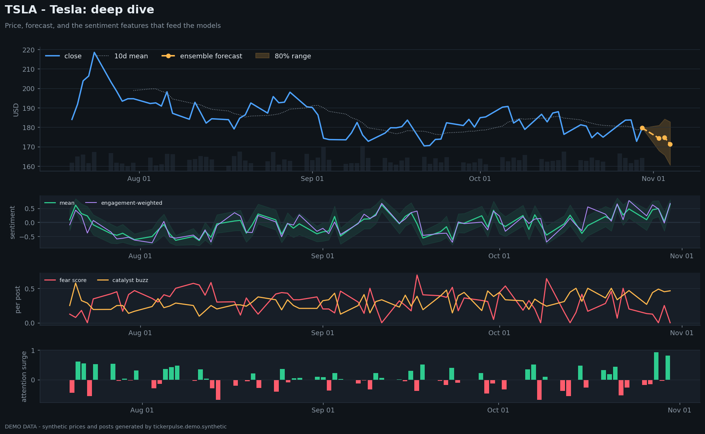
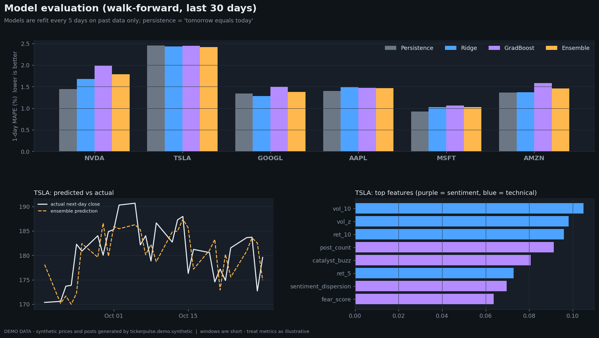
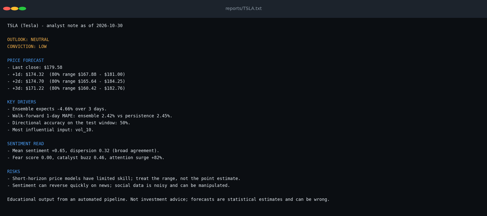

# TickerPulse

**Real-time market data + crowd-sentiment analytics for any list of stocks**
Stream prices, Reddit, StockTwits and news through Kafka and Spark into MongoDB, turn the text into daily sentiment features, forecast prices with a walk-forward-validated model ensemble, and generate an analyst note per ticker

Works for any ticker set - `NVDA, TSLA, GOOGL, AAPL, MSFT, AMZN` by default; change one env var to track others



## Architecture



| Stage | Code | What it does |
|---|---|---|
| Ingest | `tickerpulse/producers/` | One class per source (prices, Reddit, StockTwits, news); shared base handles polling, de-duplication and Kafka publishing. Ticker is the message key |
| Stream | `tickerpulse/streaming/spark_job.py` | Spark Structured Streaming reads 4 topics, parses against `schemas.py`, upserts to MongoDB (restart-safe) |
| Store | `tickerpulse/storage.py` | MongoDB helpers + unique indexes |
| Features | `tickerpulse/analytics/sentiment.py`, `features.py` | Dependency-free finance-aware sentiment scorer; daily per-ticker features |
| Forecast | `tickerpulse/analytics/forecast.py` | Ridge + gradient boosting on log-returns (1-3 day horizons), compared with a persistence baseline in walk-forward validation |
| Report | `tickerpulse/analytics/report.py` | Rule-based note, or any OpenAI-compatible LLM if configured. Optional webhook delivery |

### Sentiment features (per ticker, per day)
`sentiment_mean`, `sentiment_dispersion` (disagreement), `fear_score`, `catalyst_buzz`
(per-ticker product/catalyst keywords), `engagement_sentiment` (like/score-weighted),
`bull_ratio` (human bullish/bearish labels), `post_count`, `attention_surge` (vs 7-day average)




## Quick start

### 1. Try it offline (no Docker, no accounts)
```bash
pip install -r requirements.txt
python -m tickerpulse.analytics.pipeline --demo --tickers TSLA GOOGL NVDA
python -m tickerpulse.demo.screenshots --out docs/screenshots
python tests/test_core.py
```

### 2. Run the live pipeline
```bash
cp .env.example .env                 # edit TICKERS, MONGO_URI, ...
docker compose up -d                 # Kafka, MongoDB, Spark
./scripts/init_topics.sh             # create topics
python -m tickerpulse.producers.run_all            # start all producers (add --dry-run to just print)
spark-submit --master spark://localhost:7077 \
  --packages org.apache.spark:spark-sql-kafka-0-10_2.12:3.5.1 \
  tickerpulse/streaming/spark_job.py
python -m tickerpulse.analytics.pipeline           # features -> forecast -> notes in ./reports
python -m tickerpulse.analytics.pipeline --schedule 08:30   # or run it daily
```

### Optional integrations (all via `.env`)
- `LLM_API_URL`, `LLM_API_KEY`, `LLM_MODEL` - any OpenAI-compatible chat endpoint writes the note instead of the built-in rules
- `REPORT_WEBHOOK_URL` - POSTs each note as `{"text": ...}` (Slack-style/generic webhook)

## Model evaluation



Forecasts are evaluated **walk-forward** (refit on past data only) against a "tomorrow = today" baseline
On the demo data the models roughly tie with the baseline - which is the honest expectation for short-horizon price prediction. Treat the forecast range, not the point estimate, as the useful output



## Project layout
```
tickerpulse/
  config.py  schemas.py  storage.py
  producers/   base.py prices.py reddit.py stocktwits.py news.py run_all.py
  streaming/   spark_job.py
  analytics/   sentiment.py features.py forecast.py report.py pipeline.py
  demo/        synthetic.py screenshots.py
scripts/init_topics.sh   docker-compose.yml   tests/
```
